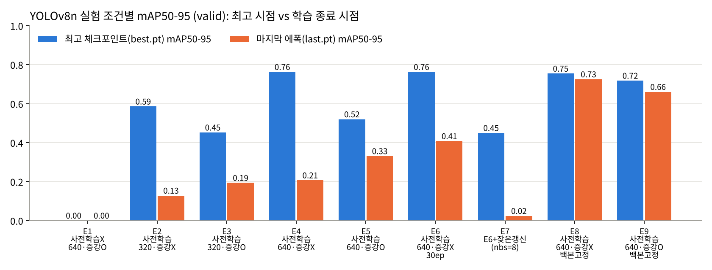
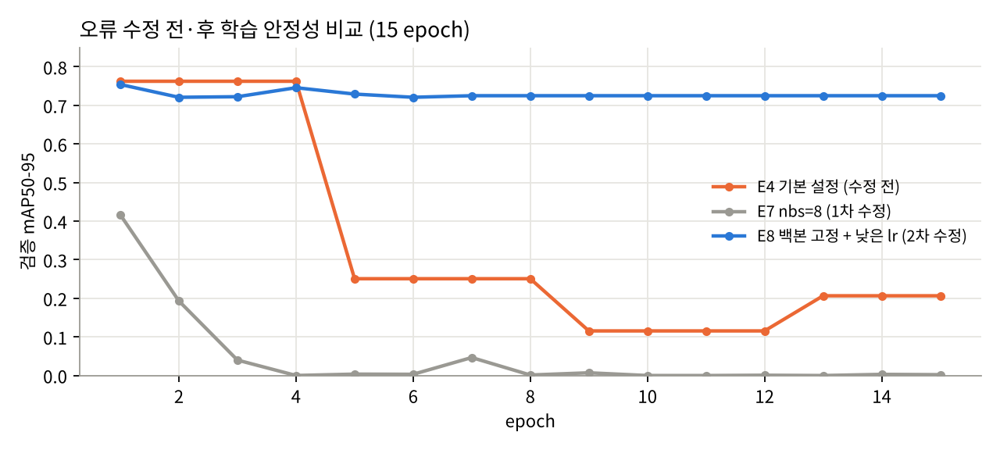
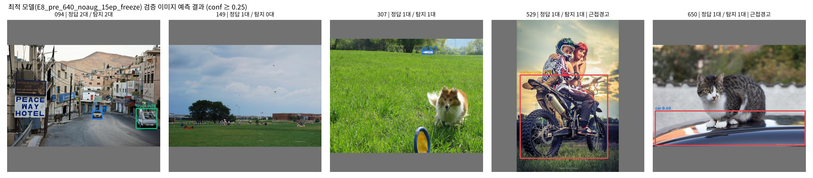

# 🚗 소량 데이터 기반 도로 차량 탐지 (CNN + YOLOv8)

> 자율주행 인지(perception)의 첫 단계인 **"도로 위 차량 찾기"**를 이미지 20장, CPU만으로 10분 안팎에 실습한 프로젝트

## 1. 문제 인식
- 자율주행·ADAS는 카메라 영상에서 차량을 찾아 **거리·위험도**를 판단해야 한다.
- 실제 현장(학교 실습, 신규 도로 환경)에서는 **라벨링된 데이터가 적고 GPU도 없다.**
- 탐구 질문: *"수십 장의 이미지만으로도 쓸 만한 차량 탐지기를 만들 수 있을까? 어떤 조건(사전학습·증강·해상도)이 가장 효과적일까?"*

## 2. 폴더 구조
```
├── src/
│   ├── preprocess.py         # 수집·정제·분할·증강·리사이즈 (데이터 전처리 파일)
│   ├── visualize_data.py     # EDA 시각화
│   ├── train_cnn.py          # CNN 차량/비차량 분류 + 그리드 탐색
│   ├── train_yolo.py         # YOLOv8n 탐지 + 조건별 실험
│   ├── visualize_results.py  # 결과 그래프
│   └── predict.py            # 예측 + 근접 차량 경고
├── figures/                  # 그래프·예측 이미지
├── results/                  # 실험 CSV/JSON
├── roboflow_upload/          # Roboflow 업로드용 YOLO 포맷 데이터셋
└── requirements.txt
```

## 3. 실행 방법

### GitHub에서 바로 실행 (설치 필요 없음)
**Actions (버튼으로 실행):** 위쪽 Actions 탭 → Run vehicle detection → Run workflow → quick(약 6분, YOLO는 최적 조건 E8만) 또는 full(약 40분, YOLO 실험 9개) 선택 → 실행이 끝나면 실행 페이지 아래 Artifacts에서 results 파일(그래프·결과)을 내려받기

**Codespaces (브라우저 속 VS Code):** Code 버튼 → Codespaces → Create codespace on main → 라이브러리 자동 설치가 끝나면 터미널에서 `bash run_all.sh` 입력 (전체 실험은 `bash run_all.sh full`)

### 내 PC에서 실행
```bash
pip install -r requirements.txt
# COCO128 다운로드 → raw/coco128
curl -L -o coco128.zip https://github.com/ultralytics/assets/releases/download/v0.0.0/coco128.zip && unzip coco128.zip -d raw
python src/preprocess.py          # data/ 생성
python src/visualize_data.py      # figures/01~07
python src/train_cnn.py           # results/cnn_*.csv, json
python src/train_yolo.py          # results/yolo_experiments.csv
python src/visualize_results.py   # figures/08~13
python src/predict.py             # figures/14
```

## 4. 데이터
- 출처: COCO128 (COCO 2017 train 앞 128장, Ultralytics 배포) 중 **차량이 있는 20장** 선별
- 클래스: car / bus / truck / motorcycle
- 전처리: 클래스 재매핑 → 소형 박스(면적 0.05% 미만) 제거 → train 15 / valid 5 분할 → 640 letterbox → train만 3종 증강(좌우반전·밝기·블러) → 60장
- CNN용: 박스를 잘라 64×64 차량 패치, 사람·사물 박스를 비차량 패치로 사용

## 5. 결과 요약
| 모델 | 최적 조건 | 핵심 지표 |
|---|---|---|
| CNN (차량/비차량 분류) | lr=1e-3, 증강X, 30 epoch | 검증 정확도 0.84 ± 0.08 (3 seed) |
| YOLOv8n (차량 탐지) | 사전학습 + 640 + 백본 고정(freeze=10) + SGD lr 0.001, 15 epoch | mAP50 0.91 / mAP50-95 0.75 (마지막 에폭 0.73), 학습 84초 |





> ⚠️ 한계: 검증 5장이 COCO 학습셋 이미지라 사전학습 모델이 이미 학습한 데이터일 수 있음(데이터 누수) → 실제 도로 영상에서는 성능이 더 낮을 것으로 예상.

## 6. 오류 수정 기록
| 문제 | 원인 | 해결 |
|---|---|---|
| `pip install torch --index-url .../cpu` 403 | 네트워크 정책상 PyTorch 전용 인덱스 차단 | PyPI 기본 인덱스로 설치 |
| `best.pt` 없음 (FileNotFoundError) | Ultralytics가 상대경로 project 앞에 `runs/detect/` 를 붙임 | `project=os.path.abspath("runs")` 로 수정 |
| YOLO 미세조정 시 5에폭부터 mAP50-95 0.76→0.25 붕괴, 값이 4에폭씩 반복 | ① nbs=64 기본값 → 15장·batch 8에선 4에폭에 1번만 가중치 갱신 ② 갱신 시 사전학습 특징 손상(망각) | 1차: nbs=8 (E7) → 오히려 더 빨리 붕괴 / 2차: `freeze=10` 백본 고정 + SGD lr0=0.001 (E8) → 마지막 에폭 0.21→0.73 안정화 |
| CNN 검증 정확도가 실행마다 크게 변동 | valid 패치 15개뿐 | 조건별 3 seed 평균·표준편차로 비교 |
| 실습 환경에서 Roboflow API 접속 차단 | 서버 네트워크 허용 목록에 roboflow.com 없음 | YOLO 포맷 폴더를 만들어 Roboflow 웹 화면에서 업로드 |
| PyPI torch 설치 시 CUDA 라이브러리 약 3GB 다운로드 | 기본 torch 휠이 GPU 의존성 포함 | 설치 대기(약 15분), 이후 `device="cpu"` 명시 |

## 7. Roboflow
`roboflow_upload/` 폴더(YOLO 포맷, data.yaml 포함)를 Roboflow 프로젝트에 그대로 드래그해 업로드 → Generate Version(Resize 640, Flip, Brightness, Blur) → Train.
